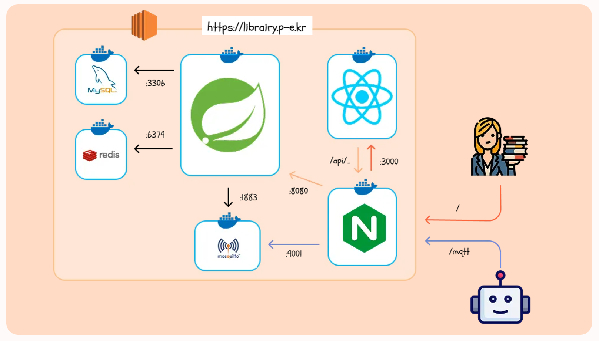
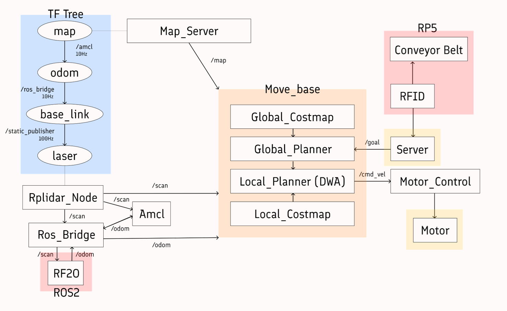

# LibrAIry: 도서관 자율주행 로봇 시스템

<p align="center">
  
</p>

SSAFY 공통 프로젝트 : 도서관 내 자율주행 로봇을 이용한 도서 분류 및 회수 시스템<br>
개발 기간 : 2025/01/06 ~ 2025/02/21 (7주)

## 프로젝트 소개

**LibrAIry**는 도서관 환경에서 자율주행 로봇을 활용하여 도서 대출/반납 자동화, 회수 구역 관리, 알림 제공 등을 구현한 스마트 라이브러리 시스템입니다.

로봇을 통한 실시간 도서 처리와 사용자 웹 서비스를 연계하여 도서관 업무 자동화와 이용자 편의성을 동시에 추구합니다.

### 배포 주소

- 웹사이트 주소: https://librairy.p-e.kr<br>
- Frontend 서버: `https://librairy.p-e.kr`<br>
- Backend 서버: `https://librairy.p-e.kr/api/`<br>
- MQTT Broker (WebSocket): `wss://librairy.p-e.kr/mqtt`<br>

### 팀 소개

| 이름   | 역할  | GitHub 링크                                | 비고                     |
| ------ | ----- | ------------------------------------------ | ------------------------ |
| 김찬호 | AI/EM | [@nonamed19](https://github.com/nonamed19) | 하드웨어 및 AI           |
| 김현희 | FE    |                                            | 프론트엔드 리더          |
| 문예찬 | AI/EM |                                            | 하드웨어 및 AI           |
| 윤상민 | BE    |                                            | 백엔드 리더, 인프라 구축 |
| 이현정 | AI    |                                            | AI 리더                  |
| 홍정주 | AI    |                                            | EM 리더더                |

---

## 시작 가이드

### Requirements

```
- Java 17
- Gradle 8.11.1
- Node.js 18+
- Spring Boot 3.4.1
- MySQL 8.0.41
- Redis 7.4.2
- Mosquitto 2.0.20 (MQTT Broker)
```

### Installation

```bash
$ git clone https://https://github.com/nonamed19/LibrAIry__Library_AI_Robotics.git
$ cd librAIry
$ docker-compose up --build
```

## 기술 스택

### Environment

- OS: Windows, Ubuntu 20.04
- HW: Raspberry Pi 4B, Jetson Orin Nano
- Backend: Spring Boot + JPA + Redis + MQTT + WebSocket
- Frontend: React + Tailwind CSS
- DB: MySQL, Docker
- API: Kakao 책 검색 API

### Config

- 배포: Nginx + Docker Compose + HTTPS

### Development

- MQTT: Mosquitto Broker + Spring Integration

## 화면 구성

|                                  기본 기능 페이지                                  |                               도서 대출 페이지                               |
| :--------------------------------------------------------------------------------: | :--------------------------------------------------------------------------: |
|  |  |
|                                  도서 반납 페이지                                  |                               도서 반납 페이지                               |
|     |  |

## 주요 기능

- 자율주행 및 도서 운반: 로봇이 도서관 내부를 자율주행하며 도서를 회수하고 지정된 장소로 운반
- 도서 관리 시스템 통합: 로봇이 도서 정보를 관리 시스템을 통해 실시간 상태 업데이트
- 효율적 도서 분류: 도서 정보를 스캔하여 원래의 분류 위치를 자동으로 식별
- 작업 효율성 제공: 사서가 회수 구역에서 도서를 간단히 확인 및 최종 정리 가능
- 대출: 로봇 위에 올려둔 도서 정보를 읽어 사용자에게 대출 처리
- 반납: 로봇 위에 올려둔 도서 정보를 읽어 사용자에게 반납 처리 후 도서 분류 및 회수
- 위치 정보: 음성을 통해 특정 도서의 위치를 문의하고, 로봇이 음성으로 응답하는 서비스

## 프로젝트 기술 차별성

1. SLAM 기반 자율주행 기술

- 로봇이 LiDAR 및 카메라 센서를 사용하여 실시간으로 도서관 지도를 생성하고, 장애물을 회피하며 효율적으로 이동.
  좁은 공간에서도 안정적인 경로 탐색 가능.

2. OCR 및 RFID 통합 도서 인식

- OCR(Optical Character Recognition)로 도서 표지 정보를 읽거나, RFID를 활용해 도서 정보를 빠르게 식별.
  다양한 방식의 도서 인식 기술로 사용 환경에 유연하게 대응.

3. DB 기반 관리 시스템

- 로봇에서 수집된 데이터를 DB에 저장하여 도서 분류 상태를 원격으로 모니터링 가능.

## 아키텍쳐

### 아키텍쳐 다이어그램

<p align="center">
  

### ROS 네트워크 구성도

<p align="center">
  

## 기타 추가 사항들

향후 계획:

- 로봇 위치 기반 실시간 위치 추적 지도 제공
- 음성 안내 시스템 연동
- 장애물 회피 자율 주행 알고리즘 고도화
- 도서관 배치도 기반 경로 최적화
- WebRTC를 통한 관리자-로봇 실시간 원격 제어 기능
